# System Architecture Documentation

## Table of Contents
1. [High-Level Architecture](#high-level-architecture)
2. [Component Architecture](#component-architecture)
3. [Agent System Architecture](#agent-system-architecture)
4. [Data Flow Diagrams](#data-flow-diagrams)
5. [Database Schema](#database-schema)
6. [Deployment Architecture](#deployment-architecture)
7. [Security Architecture](#security-architecture)
8. [Integration Architecture](#integration-architecture)

---

## High-Level Architecture

### System Overview

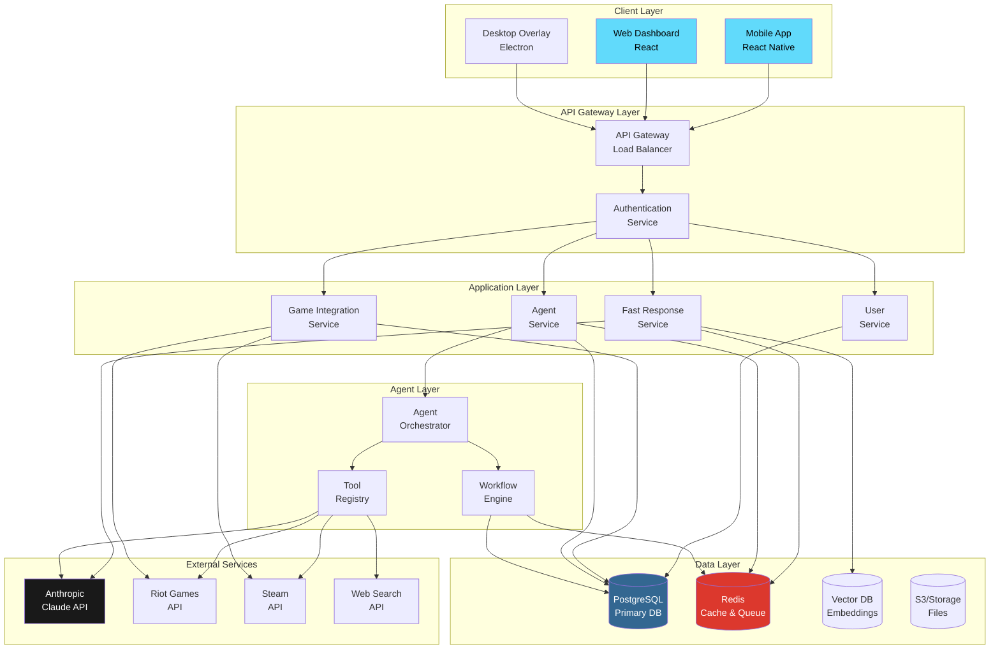

### Architecture Principles

1. **Separation of Concerns**: Fast responses and agentic tasks are handled by separate services
2. **Scalability**: Horizontal scaling for API and agent services
3. **Resilience**: Circuit breakers, retries, and fallback mechanisms
4. **Security**: Authentication at gateway, encrypted data at rest and in transit
5. **Observability**: Comprehensive logging, metrics, and tracing

---

## Component Architecture

### Layered Architecture

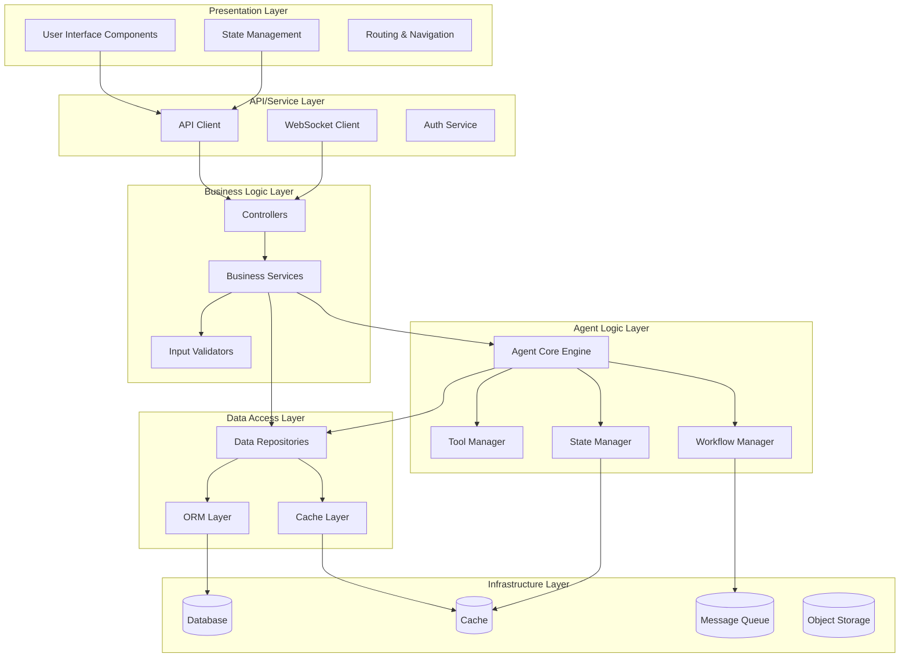

### Component Responsibilities

| Layer | Components | Responsibilities |
|-------|-----------|------------------|
| **Presentation** | UI, State, Routing | User interaction, display logic, navigation |
| **API/Service** | API Client, WebSocket | Communication with backend, real-time updates |
| **Business Logic** | Controllers, Services | Business rules, orchestration, validation |
| **Agent Logic** | Agent Core, Tools, Workflows | AI reasoning, tool execution, task management |
| **Data Access** | Repositories, ORM | Data persistence, caching, queries |
| **Infrastructure** | Database, Cache, Queue | Data storage, message passing, file storage |

---

## Agent System Architecture

### Agent Execution Flow

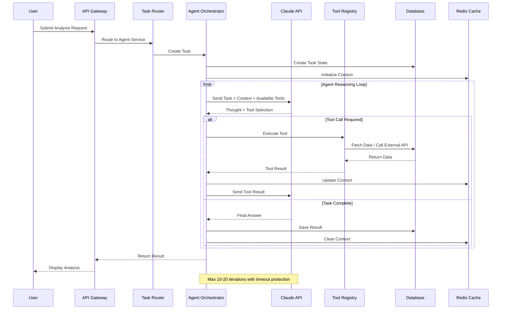

### Agent State Machine

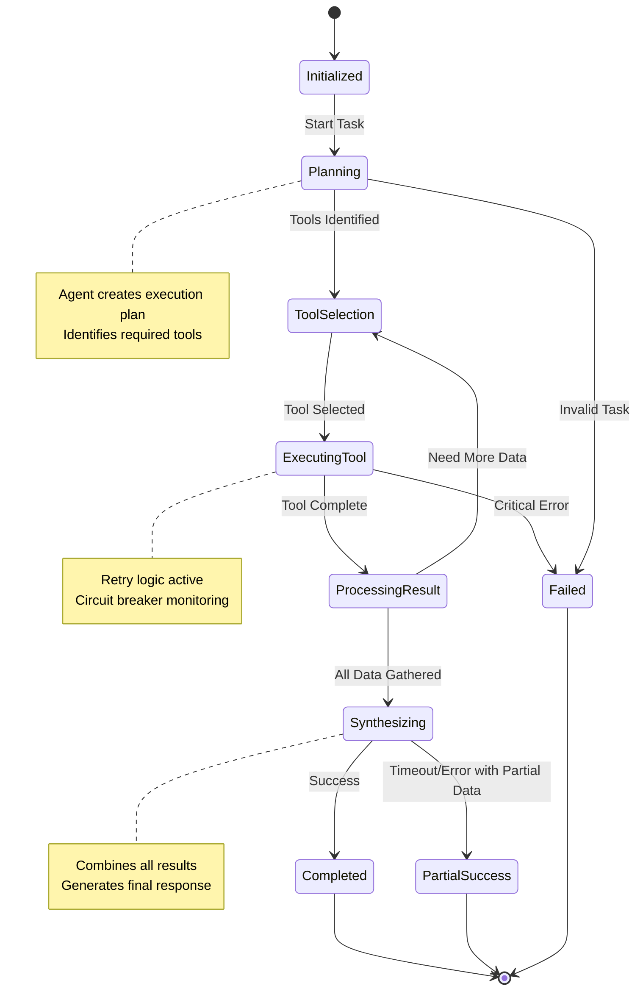

### Tool Execution Architecture

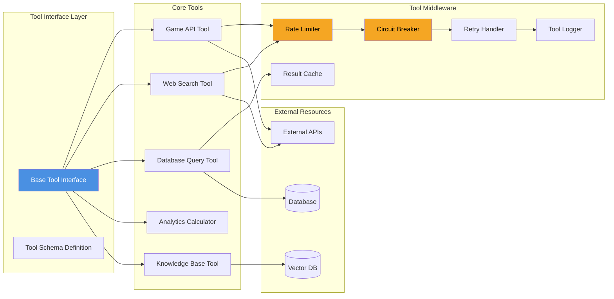

---

## Data Flow Diagrams

### User Query Flow (Fast Response)

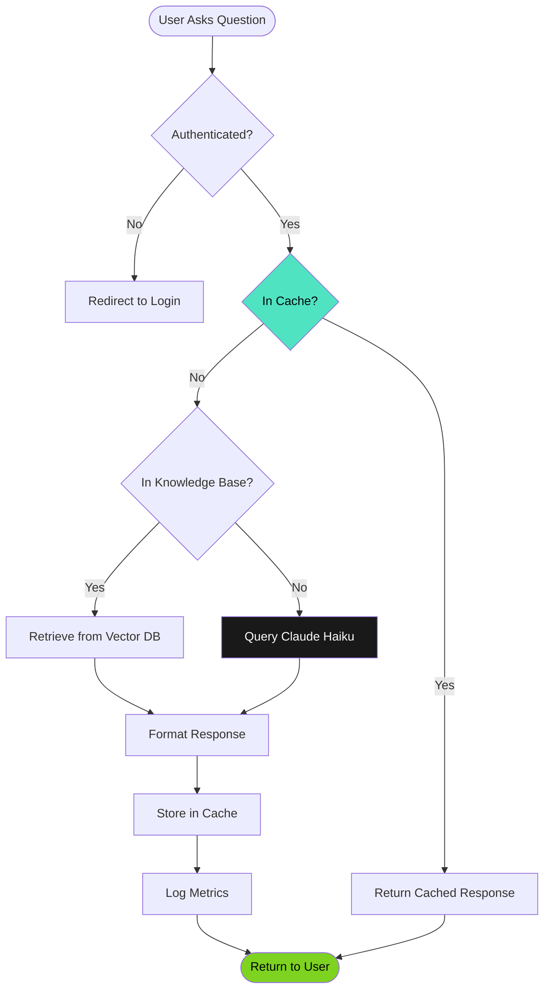

### Agent Analysis Flow (Deep Analysis)

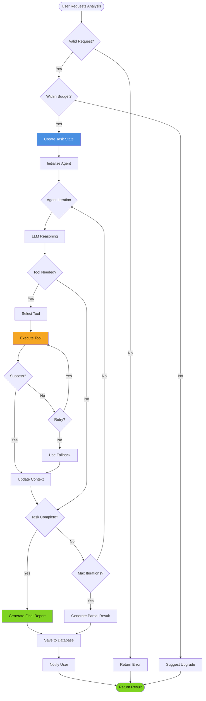

### Match Analysis Workflow

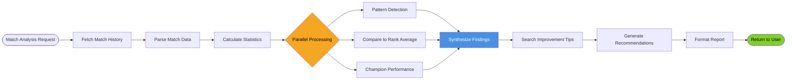

---

## Database Schema

### Entity Relationship Diagram

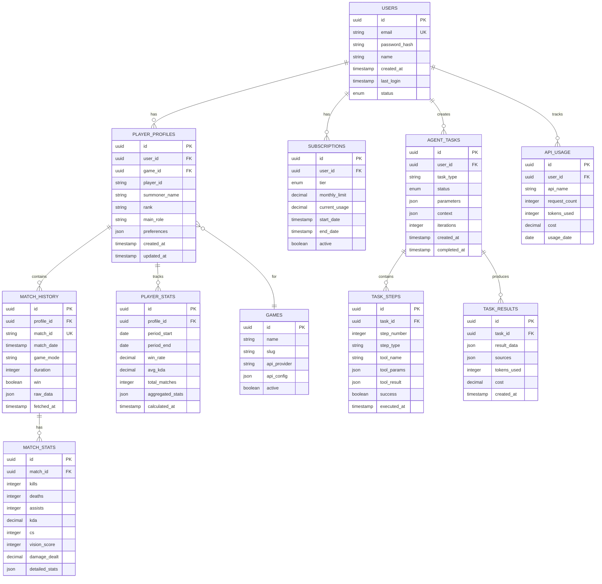

### Key Tables Description

| Table | Purpose | Key Relationships |
|-------|---------|-------------------|
| **USERS** | Core user accounts | Links to all user-specific data |
| **SUBSCRIPTIONS** | Billing and tier management | One per active user |
| **PLAYER_PROFILES** | Game-specific player data | Multiple profiles per user per game |
| **MATCH_HISTORY** | Raw match data from APIs | Linked to player profiles |
| **AGENT_TASKS** | Track agent executions | Contains all task metadata |
| **TASK_STEPS** | Individual agent steps | Detailed execution trail |
| **TASK_RESULTS** | Final agent outputs | Synthesized results and costs |

---

## Deployment Architecture

### Production Infrastructure

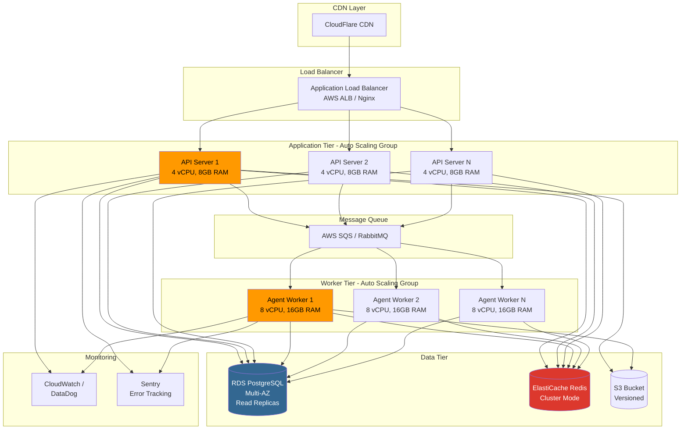

### Container Architecture (Docker/Kubernetes)

```mermaid
graph TB
    subgraph "Kubernetes Cluster"
        subgraph "Ingress"
            Ingress[Nginx Ingress Controller]
        end
        
        subgraph "API Namespace"
            APIPod1[API Pod 1]
            APIPod2[API Pod 2]
            APIService[API Service<br/>Load Balancer]
        end
        
        subgraph "Worker Namespace"
            WorkerPod1[Worker Pod 1]
            WorkerPod2[Worker Pod 2]
            WorkerService[Worker Service]
        end
        
        subgraph "Storage"
            PVC[Persistent Volume Claims]
        end
        
        subgraph "Config"
            ConfigMap[ConfigMaps]
            Secrets[Secrets]
        end
    end
    
    subgraph "External Services"
        ExternalDB[(External RDS)]
        ExternalRedis[(External Redis)]
    end
    
    Ingress --> APIService
    APIService --> APIPod1
    APIService --> APIPod2
    
    APIPod1 --> ExternalDB
    APIPod1 --> ExternalRedis
    APIPod2 --> ExternalDB
    APIPod2 --> ExternalRedis
    
    WorkerPod1 --> ExternalDB
    WorkerPod1 --> ExternalRedis
    WorkerPod2 --> ExternalDB
    WorkerPod2 --> ExternalRedis
    
    APIPod1 -.-> ConfigMap
    APIPod1 -.-> Secrets
    WorkerPod1 -.-> ConfigMap
    WorkerPod1 -.-> Secrets
    
    APIPod1 --> PVC
    WorkerPod1 --> PVC
    
    style Ingress fill:#326CE5,color:#fff
    style APIPod1 fill:#326CE5,color:#fff
    style WorkerPod1 fill:#326CE5,color:#fff
```

---

## Security Architecture

### Authentication & Authorization Flow

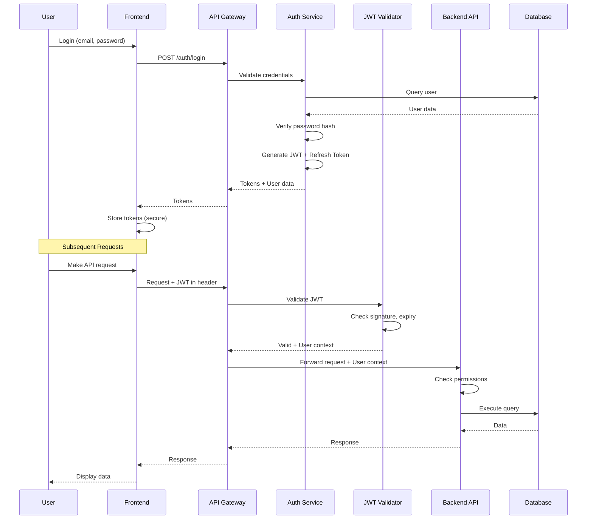

### Security Layers

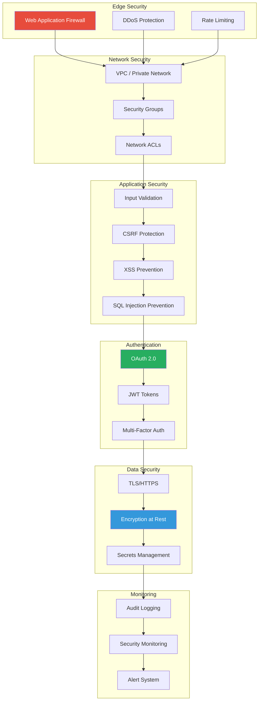

---

## Integration Architecture

### External API Integration Pattern

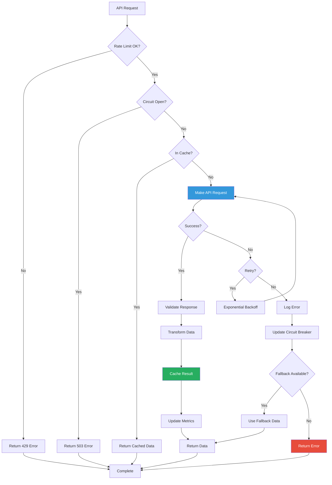

### Webhook Processing

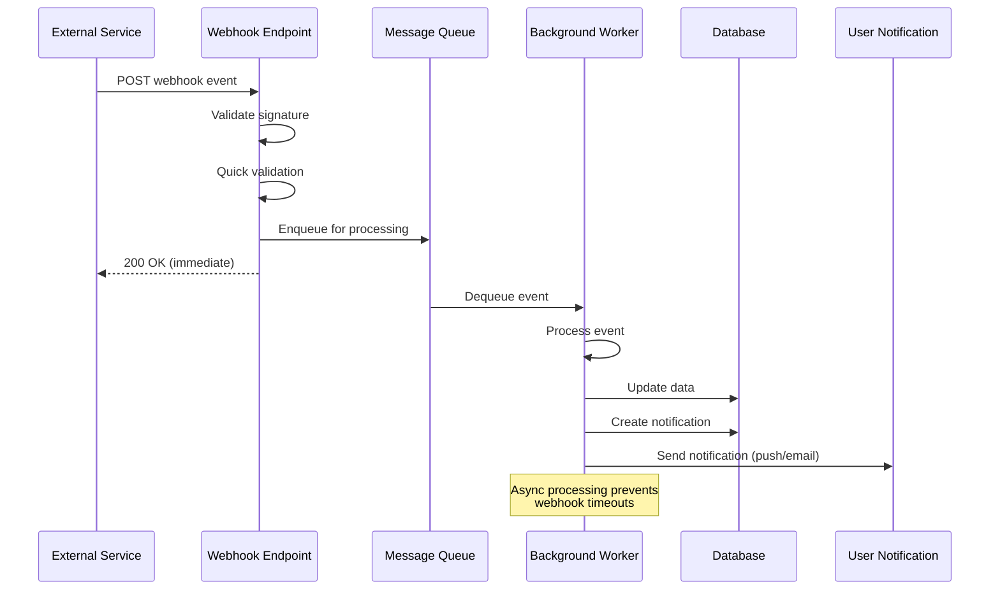

---

## Performance Optimization

### Caching Strategy

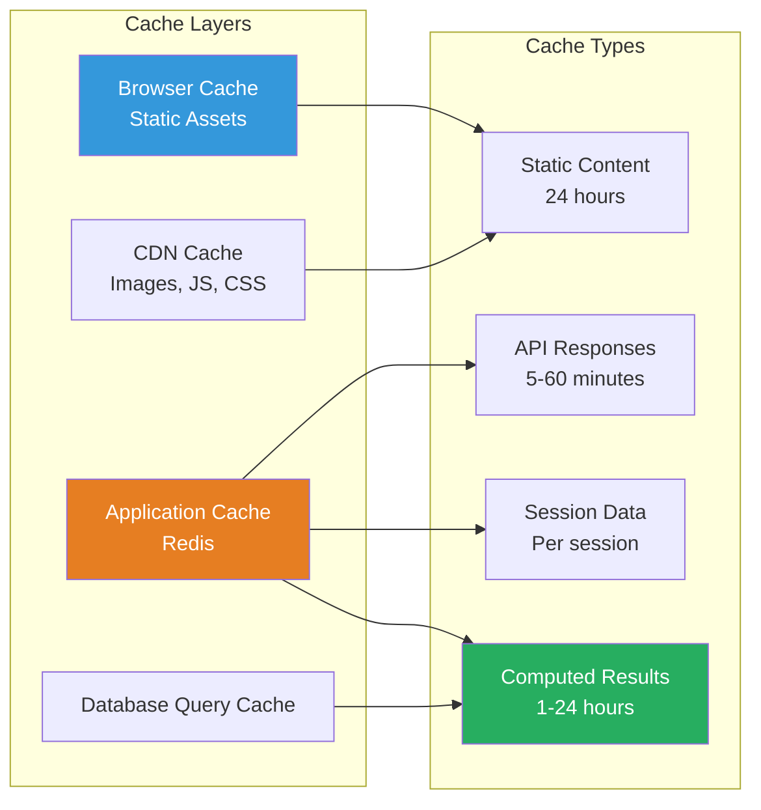

### Scaling Strategy

| Component | Scaling Type | Trigger | Max Instances |
|-----------|--------------|---------|---------------|
| API Servers | Horizontal | CPU > 70% | 10 |
| Agent Workers | Horizontal | Queue depth > 50 | 20 |
| Database | Vertical + Read Replicas | Connections > 80% | 1 primary + 5 replicas |
| Redis | Horizontal (Cluster) | Memory > 75% | 6 nodes |

---

## Appendix

### Technology Stack Summary

| Layer | Technology | Purpose |
|-------|-----------|---------|
| **Frontend** | React / React Native | User interface |
| **API Gateway** | Nginx / AWS ALB | Load balancing, SSL termination |
| **Backend** | Node.js / Python FastAPI | Application logic |
| **Agent Engine** | Python + Claude API | AI reasoning and tools |
| **Database** | PostgreSQL | Primary data store |
| **Cache** | Redis | Session, cache, queue |
| **Vector DB** | Pinecone / Weaviate | Embeddings for knowledge base |
| **Storage** | AWS S3 | File storage |
| **Queue** | AWS SQS / RabbitMQ | Async task processing |
| **Monitoring** | DataDog / CloudWatch | Metrics and logging |
| **Error Tracking** | Sentry | Error monitoring |

### Architecture Decision Records (ADRs)

**ADR-001: Separate Fast and Agent Services**
- **Decision**: Split into fast response and agentic layers
- **Rationale**: Different latency requirements and resource needs
- **Status**: Accepted

**ADR-002: Use PostgreSQL for Primary Database**
- **Decision**: PostgreSQL instead of MongoDB
- **Rationale**: Strong ACID guarantees, JSON support, mature ecosystem
- **Status**: Accepted

**ADR-003: Claude API as Primary LLM**
- **Decision**: Anthropic Claude for agent reasoning
- **Rationale**: Strong tool use, long context window, cost-effective
- **Status**: Accepted

**ADR-004: Redis for Caching and Queue**
- **Decision**: Redis for both cache and message queue
- **Rationale**: Proven performance, simple deployment, versatile
- **Status**: Accepted

---

**Last Updated**: November 2025  
**Document Version**: 1.0  
**Maintained By**: Engineering Team